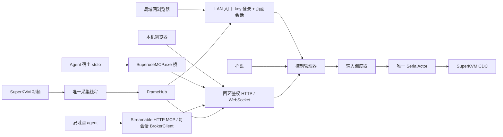

# 架构

Superuse 在 Windows 控制端将一个 SuperKVM 的视频与键鼠能力交给浏览器和多个 MCP agent。目标端不安装组件；支持范围由设备 USB 身份和协议决定，不绑定某种目标操作系统。

## 1. 技术选择

Python 3.12 负责调度和应用生命周期；OpenCV 采集/编码，pyserial 连接 CDC，aiohttp 提供回环 HTTP/WebSocket 与局域网浏览器入口，uvicorn 在同一事件循环上承载官方 MCP SDK 的 Streamable HTTP ASGI 应用，pystray 提供托盘。MCP 经 stdio（`SuperuseMCP.exe` 桥）与 Streamable HTTP（`Superuse.exe` 内 `lan_host:mcp_port/mcp`）接入。人工页面为本地 HTML/CSS/JavaScript，无前端运行依赖或 CDN。

依赖通过 `uv.lock` 固定。源码的 `app` extra 包含业务依赖，`packaging` extra 包含 PyInstaller。Windows 包采用 onedir：有窗口属性的托盘 EXE 与保留标准输入输出的 MCP EXE 共享依赖。

## 2. 进程与线程

broker 与托盘在同一进程，主线程处理托盘消息，后台线程运行 asyncio（aiohttp 与 uvicorn 共用该循环，无跨线程调用）。托盘回调向事件循环提交操作，不直接写串口。stdio 桥是独立进程，只持有 broker 会话，不持有硬件句柄；HTTP MCP 服务在 broker 进程内，每个 MCP 传输会话（`Mcp-Session-Id`）懒创建一个独立的 `BrokerClient`（独立 broker 会话、租约与续租），会话终止即关闭并释放。

真实设备默认：设备在启动时缺席不阻塞服务生命周期（托盘/本机页面/stdio 状态先行就绪），`DeviceSupervisor` 按既有退避梯子反复尝试接入串口与采集，接入后走同一恢复/中和路径。串口执行器以唯一写线程排序普通输入和释放屏障，并在每次实际写入时核对授权。独立接收循环解析只读扩展信息。单采集线程持有视频设备，将最新帧交给 FrameHub；多个浏览器和 MCP 截图共享此源。

原生采集 read 卡住时，Python 不能安全强杀线程。旧源不能确认关闭时禁止开启第二个源；提示应用重启。采集恢复不重放输入。

## 3. 模块边界

| 路径 | 责任 |
|---|---|
| `src/superuse/app.py` | broker 组装、设备监督、LAN 开关事务、启动与关闭 |
| `src/superuse/buildenv.py` | frozen 发布边界（发布构建拒绝模拟设备） |
| `src/superuse/config.py` | 配置合并、严格校验与旧 simulated 配置迁移 |
| `src/superuse/paths.py` | 托盘/CLI/MCP 共享的常规与 portable 路径发现 |
| `src/superuse/core/` | 控制权、租约、Job、调度、坐标 basis、帧缓存 |
| `src/superuse/device/` | 设备发现、协议、串口执行器、真实/模拟采集 |
| `src/superuse/server/` | 回环 HTTP/WS、LAN 入口与网络访问策略、会话和消息边界 |
| `src/superuse/mcp/` | stdio/HTTP 共用工具、broker 客户端、HTTP transport 服务、续租和取消 |
| `src/superuse/windows/` | 托盘（LAN 开关/地址复制/重新检测）、单实例、ACL 与诊断脱敏 |
| `web/` | 人工页面和本地资源 |
| `schemas/`、`examples/` | 字段契约、正反例和协议向量 |

core 不依赖 Windows GUI、aiohttp 或 MCP。传输层只做认证、校验、转换和呈现，不绕过控制器访问设备。

## 4. 输入与控制权

一个设备一次只有一个输入所有者，可有多个观察者。人工显式接管会先撤销旧 generation、取消旧作业并完成释放屏障，然后授予新租约。旧作业 finally、旧页面关闭和迟到连接清理都不能释放新所有者的输入。

租约绑定 instance、session、lease_id 和 generation。正常输入还要求设备健康、画面新鲜；绝对坐标额外校验 basis。相对工具不接受绝对像素，按有界 HID 计数展开。

人工失焦或断连进入 human_hold，保留人工优先，必须主动交还。MCP 桥只在作业运行或近期有输入时续租，空闲释放；工具不隐式 acquire。详细规则见[控制状态机](control-state-machine.md)与[接口契约](api-contract.md)。

## 5. 视频与范围

FrameHub 绑定帧元数据、缩放尺寸和 basis，保留有界编码缓存。人工预览最大宽 1920、JPEG quality 90，MCP 默认宽 1280、quality 80；均不放大源图。服务端和浏览器使用最新帧策略，慢消费者不积压历史视频。

网络访问面向可信局域网：明文 HTTP/WS，单一共享 key 准入（远程浏览器登录与 HTTP MCP Bearer），无 HTTPS、证书、OAuth、账号或配对审批；LAN 默认关闭，由托盘事务式开启。发布（frozen）构建只有真实设备模式并迁移旧 simulated 配置；模拟仅存在于开发源码与测试 fixture（显式注入）。

当前范围不包含音频、文件传输、剪贴板、任意 Unicode、OTA、公网映射/NAT 穿透、目标电源管理、多设备并行或 Windows Service。
